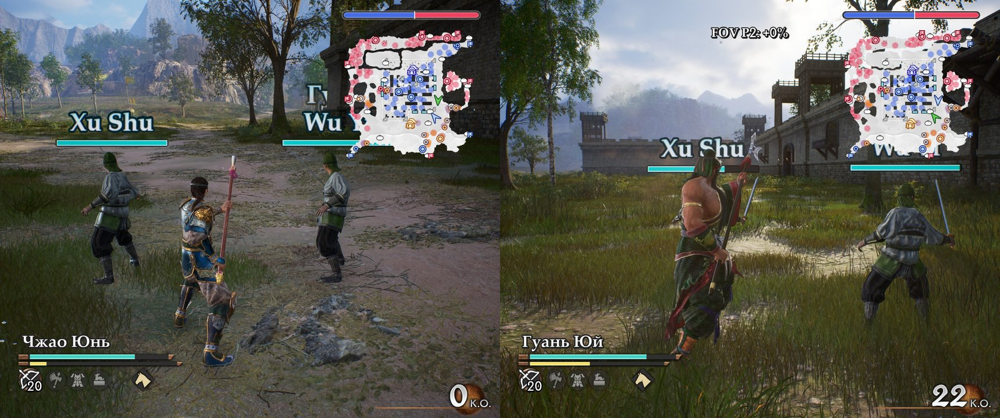
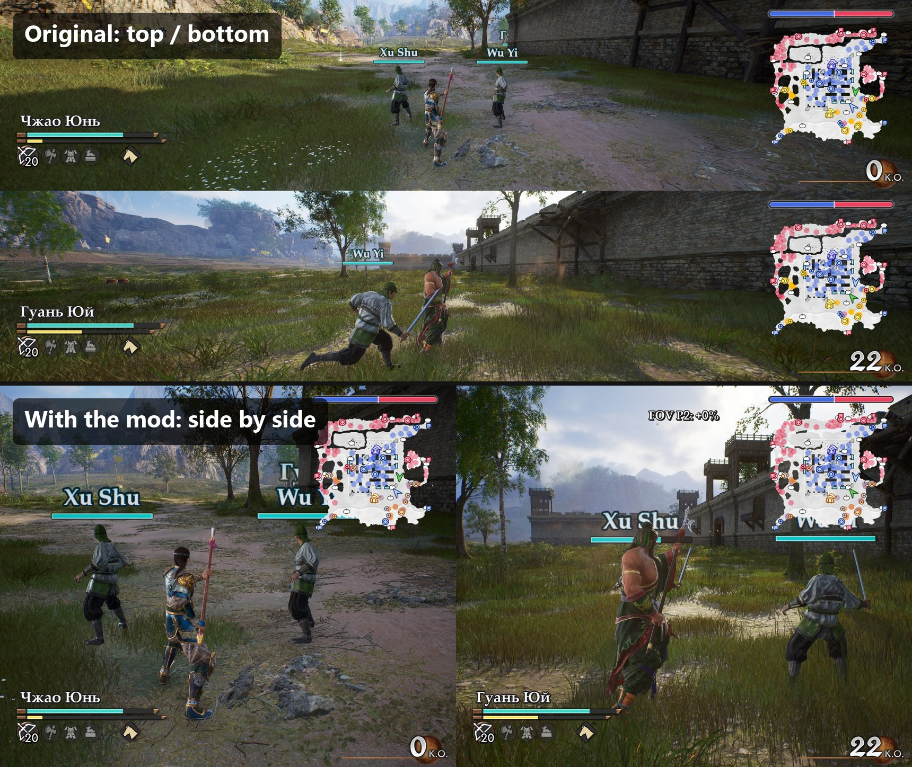
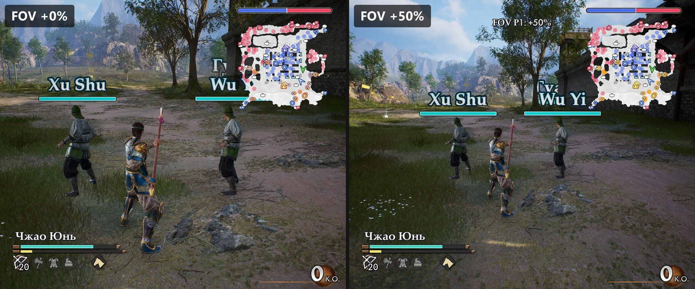

# Vertical Split Screen — DYNASTY WARRIORS 3: Complete Edition Remastered



A [UE4SS](https://github.com/UE4SS-RE/RE-UE4SS) Lua mod that makes the local 2-player split screen split **side by side** (Player 1 left, Player 2 right) instead of top/bottom, which works much better on wide and ultrawide monitors.

## Before / after



## Features

- **Side-by-side split** for local co-op and versus.
- **HUD follows the split**: each player's health, musou, officer gauge, morale, minimap and K.O. counter are moved into that player's half.
- **Switch the split** between side-by-side and the original top/bottom at any time, even mid-battle. The HUD follows.
- **Per-player wider view** (side-by-side mode only): each player can widen their FOV by 0–50%. It works on top of the game's camera, so zooms during musou attacks keep working. Cutscenes are untouched.
- **Per-player HUD scale** (50–200%) for the own HP gauge, the strong enemy's gauge and the minimap block, in both split modes.
- **In-game settings menu** on three keys, shown in the player's half of the screen.
- All settings are remembered between sessions.
- No game files are modified.

### Wider view per player



## Requirements

- DYNASTY WARRIORS 3: Complete Edition Remastered (Steam).
- UE4SS for this game: [Nexus Mods, mod #7](https://www.nexusmods.com/dynastywarriors3completeeditionremastered/mods/7).

## Installation

1. Install UE4SS: `dwmapi.dll` and the `ue4ss` folder go next to `DW3CE_RE\Binaries\Win64\DW3CE_RE-Win64-Shipping.exe`.
2. Download `VerticalSplit-<version>.zip` from [Releases](../../releases) and extract it into `DW3CE_RE\Binaries\Win64`. You should end up with:
   ```
   DW3CE_RE\Binaries\Win64\ue4ss\Mods\VerticalSplit\Scripts\main.lua
   DW3CE_RE\Binaries\Win64\ue4ss\Mods\VerticalSplit\enabled.txt
   ```
3. Start a 2-player battle.

To uninstall, delete `ue4ss\Mods\VerticalSplit`.

## Controls

| Key | Action |
|---|---|
| `F8` | Next setting (its name and value are shown on screen) |
| `[` / `]` | Change the selected setting down / up |

Settings, in F8 order:

| Setting | Values | Shown in |
|---|---|---|
| Split | side by side ↔ top/bottom | both halves |
| FOV P1 / P2 | +0…+50%, step 5% (side-by-side mode only, skipped otherwise) | that player's half |
| HP gauge P1 / P2 | 50…200%, step 10% | that player's half |
| Enemy gauge P1 / P2 | 50…200%, step 10% | that player's half |
| Minimap P1 / P2 | 50…200%, step 10% (minimap with the morale bar) | that player's half |

All settings are saved to `ue4ss\Mods\VerticalSplit\settings.txt`. Keys, steps and ranges can be changed at the top of `Scripts\main.lua`.

## How it works

- **Split orientation:** the game uses Unreal Engine's stock split screen. The mod sets `GameMapsSettings.TwoPlayerSplitscreenLayout` at runtime. Editing `Engine.ini` doesn't work because the game deletes that file on exit.
- **HUD:** the 2-player HUD (`BP_2d_hud_multi`) holds two copies of the player HUD anchored to the top and bottom halves. The mod re-anchors them to the left and right halves.
- **FOV:** the game animates the camera's `FieldOfView` itself, so changing that field makes the camera fight the mod. The mod sets the camera's `Overscan` instead, which widens the view on top of whatever FOV the game picks.
- **HUD scale:** the mod finds the gauge widgets inside each player's part of the 2-player HUD (`bp_parts_gauge_pc_multi`, `BP_parts_gauge_enemy_multi`, `BP_parts_minimap`, `BP_parts_gauge_moral`) and sets their render scale, each growing from the corner it sits in.

## Building

- `package.ps1` builds `dist\VerticalSplit-<version>.zip`. The version is taken from `main.lua`.
- `deploy.ps1` copies the mod into a local game install. Pass `-Remove` to uninstall.

## Compatibility

Tested on Steam build 25630985 with UE4SS v3.0.1-1152 (experimental) in 2-player battles on a 3440×1440 monitor.

## License

[MIT](LICENSE). This is a fan-made mod, not affiliated with or endorsed by Koei Tecmo. No game assets are included.
